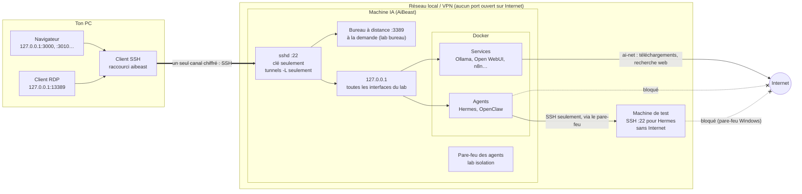
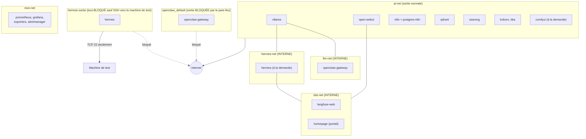
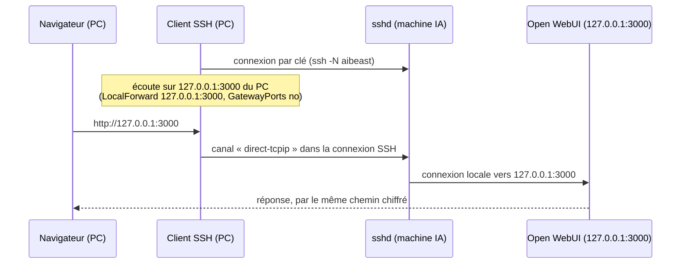
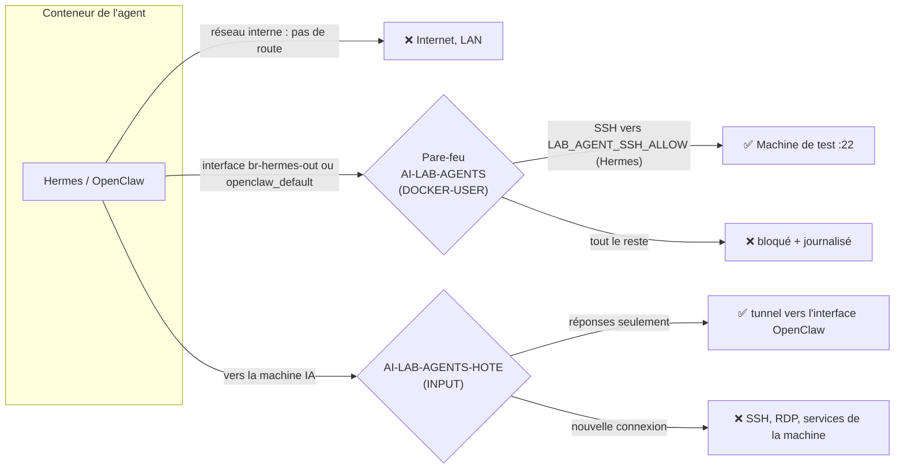
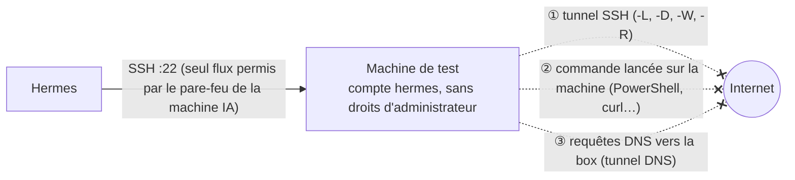

# Architecture réseau et sécurité du lab

Ce document décrit **comment les composants du lab communiquent** et **quelles protections s'appliquent à chaque
niveau**. Il est le point d'entrée pour comprendre la sécurité ; le détail de chaque mécanisme est dans les documents
cités. État décrit : 22 octobre 2026, vérifié sur la machine de référence (AiBeast : Ubuntu, Docker 29, pare-feu
iptables).

Vocabulaire : **la machine IA** (AiBeast) fait tourner tout le lab ; **ton PC** est le poste depuis lequel tu
travailles ; **la machine de test** est un ordinateur du réseau local auquel l'agent Hermes peut se connecter en SSH
(par exemple un PC Windows qui pilote du matériel).

## 1. Les principes

1. **Rien n'est exposé.** Toutes les interfaces du lab écoutent sur `127.0.0.1` de la machine IA. Seuls SSH (22) et,
   s'il est activé, le bureau à distance (3389) écoutent sur le réseau. Aucun port n'est ouvert sur Internet : l'accès
   depuis l'extérieur passe par un VPN.
2. **SSH est la seule porte d'entrée**, par clé uniquement. Ton PC y fait passer des tunnels vers les interfaces.
3. **Chaque service ne voit que ce dont il a besoin** : plusieurs réseaux Docker séparés, dont trois « internes » sans
   aucune sortie.
4. **Les agents (Hermes, OpenClaw) sont confinés** : ni Internet, ni réseau local, ni la machine IA. Ils ne parlent
   qu'au modèle local. Seule exception : SSH de Hermes vers la machine de test, elle-même privée d'Internet.
5. **Défense en profondeur** : chaque protection est doublée par une autre de nature différente (réseau Docker + pare-feu ;
   option de clé + configuration du serveur SSH ; politique de l'agent + absence de route réseau).
6. **Tout est vérifiable par une commande** : `lab doctor`, `lab isolation test`, `lab remote test NOM` (§9).

## 2. Vue d'ensemble

## 3. Les réseaux Docker

Un même conteneur peut être relié à plusieurs réseaux (Ollama est sur `ai-net`, `llm-net` et `hermes-net`). Un réseau
**interne** n'a aucune route vers l'extérieur : un conteneur qui n'est relié qu'à des réseaux internes ne peut joindre
que ses voisins. Ollama et Open WebUI sortent par `ai-net` ; les agents n'ont pas de tel réseau.

| Réseau | Type | Membres | Sortie | Rôle |
|---|---|---|---|---|
| `ai-stack_ai-net` | normal | Ollama, Open WebUI, n8n, Postgres n8n, Qdrant, SearXNG, Kokoro, Tika, ComfyUI, portail, sonde blackbox | Internet et réseau local | Services « de confiance » qui ont besoin d'Internet (modèles, recherche, Gmail) |
| `llm-net` | **interne** | Ollama, passerelle OpenClaw | aucune | OpenClaw ne voit qu'Ollama |
| `hermes-net` | **interne** | Ollama, Hermes | aucune | Hermes ne voit qu'Ollama |
| `obs-net` | **interne** | Open WebUI, Hermes, Langfuse, portail | aucune | Envoi des traces à Langfuse |
| `hermes-sortie` (`br-hermes-out`) | normal, **filtré** | Hermes | SSH vers `LAB_AGENT_SSH_ALLOW` seulement | Accès de Hermes à la machine de test |
| `openclaw_default` | normal, **filtré** | Passerelle OpenClaw | aucune connexion sortante | Publication de l'interface d'OpenClaw (entrant seulement) |
| `mon-net` | normal | Prometheus, Grafana, exporters, Alertmanager, portail, sonde | Internet (non utilisé) | Supervision, isolée des services |
| `app_default` (Langfuse) | normal | Base, ClickHouse, Redis, MinIO, Langfuse | Internet (non utilisé) | Interne au projet Langfuse |

## 4. Les ports

Tous les ports publiés par Docker sont liés à `127.0.0.1` : on n'y accède que depuis la machine IA ou par un tunnel.

| Port (machine IA) | Service | Écoute sur | Accès depuis ton PC |
|---|---|---|---|
| 22 | SSH | **réseau** | direct (clé SSH) |
| 3389 | Bureau à distance (RDP) | **réseau**, si activé (`lab bureau on`) | tunnel `127.0.0.1:13389` (ne pas l'ouvrir au pare-feu) |
| 3010 | Portail (Homepage) | 127.0.0.1 | tunnel |
| 3011 | Panneau de boutons (service utilisateur, jeton) | 127.0.0.1 | tunnel |
| 3000 | Open WebUI | 127.0.0.1 | tunnel |
| 5678 | n8n | 127.0.0.1 | tunnel |
| 6333 | Qdrant | 127.0.0.1 | tunnel |
| 8188 | ComfyUI | 127.0.0.1 | tunnel |
| 11434 | Ollama (API) | 127.0.0.1 | tunnel possible, non prévu |
| 3001 / 9090 | Grafana / Prometheus | 127.0.0.1 | tunnel |
| 3002 | Langfuse | 127.0.0.1 | tunnel |
| 9091 / 9092 | MinIO (Langfuse) | 127.0.0.1 | non prévu |
| 2586 / 9093 | ntfy / Alertmanager | 127.0.0.1 (ntfy : `NTFY_BIND`, voir §7) | tunnel |
| 18789 / 18790 / 3978 | OpenClaw (interface, bridge, canaux) | 127.0.0.1 (`~/openclaw/.env`) | tunnel (18789) |

Contrôle : `ss -tlnp | grep -vE '127\.0\.0\.1|\[::1\]|127\.0\.0\.53'` ne doit montrer que 22 (et 3389 si le bureau à
distance est actif).

## 5. L'accès depuis ton PC

| Couche | Protection | Où |
|---|---|---|
| Réseau | Pas de port ouvert sur la box ; accès extérieur par VPN | box / VPN |
| Authentification | Clé SSH uniquement (`PasswordAuthentication no`, `PermitRootLogin no`) ; une clé par appareil, au moins deux appareils | `/etc/ssh/sshd_config.d/10-durcissement.conf` |
| Redirections | `AllowTcpForwarding local` (tunnels `-L` permis, `-R` refusé), `GatewayPorts no`, `PermitTunnel no`, `AllowAgentForwarding no`, `X11Forwarding no` | idem |
| Côté PC | Tunnels liés à `127.0.0.1` du PC (`GatewayPorts no`) : une autre machine du réseau du PC ne peut pas les utiliser | config générée par `lab client` |
| Interfaces | Chaque interface garde son propre compte ou jeton (Open WebUI, n8n, Grafana, OpenClaw, panneau) | `.env` de chaque projet |
| Bureau à distance | Éteint par défaut (coûte ≈ 100 W), joint par le tunnel, identifiants RDP propres puis compte Linux | `lab bureau`, [acces-distant.md](acces-distant.md) §9 |

Détail : [acces-distant.md](acces-distant.md).

## 6. Le confinement des agents

### Ce que chacun peut joindre

| Destination | Hermes | OpenClaw | Open WebUI | Ollama | n8n |
|---|---|---|---|---|---|
| Ollama | oui | oui | oui | — | oui |
| Langfuse | oui | non | oui | non | non |
| Internet | **non** | **non** | oui (choix) | oui | oui (Gmail) |
| Réseau local | **non** (sauf machine de test, SSH) | **non** | oui | oui | oui |
| La machine IA elle-même | **non** | **non** | non (pas de besoin) | non | non |

### Comment c'est appliqué

- **Réseaux internes** (`internal: true` dans `ai-stack/docker-compose.yml`) : `llm-net`, `hermes-net`, `obs-net`.
- **Pare-feu** (`scripts/isolation-agents.sh`, service systemd `ai-lab-isolation`, réappliqué à chaque démarrage de
  Docker) : deux chaînes iptables. Les paquets bloqués sont journalisés (`journalctl -k | grep "ai-lab agent"`).
- **Politique d'OpenClaw** : modèles limités à `ollama/*` ; outils `gateway`, `automations`, `nodes`, `browser`,
  `canvas`, `computer`, `mobile_ui` et recherche web retirés ; mode élevé coupé ([openclaw.md](openclaw.md)).
- **Sessions Hermes** : arrêtées à la fermeture du terminal (`5-hermes.sh`) ; `lab doctor` signale une session de plus
  de 12 h. Six sessions oubliées, avec accès Internet, avaient été trouvées avant cette correction.

Détail : [isolation-agents.md](isolation-agents.md).

### Le lien SSH de Hermes vers la machine de test

Par ce lien, Hermes pourrait sortir de deux façons ; les deux sont fermées :

| Chemin | Protection |
|---|---|
| ① Tunnel SSH | Option `restrict` sur la clé de Hermes **et** `AllowTcpForwarding no`, `AllowStreamLocalForwarding no`, `PermitTunnel no`, `AllowAgentForwarding no`, `X11Forwarding no`, `GatewayPorts no` dans le bloc `Match User` du serveur SSH |
| ② Commandes | Pare-feu Windows : blocage sortant vers toutes les adresses publiques (IPv4 et IPv6), pour **toute** la machine (le pare-feu Windows ne sait pas viser un seul compte local) ; le compte de l'agent ne peut pas le modifier |
| ③ DNS | Blocage du port 53 en sortie |

Mise en place : `windows/outils/Isoler-machine-de-test.ps1` (en administrateur sur la machine de test). Contrôle depuis
la machine IA, avec les yeux de Hermes : `lab remote test NOM`.

## 7. Les autres protections

| Domaine | Protection | Document |
|---|---|---|
| Secrets | Mots de passe aléatoires dans des `.env` (créés par `2-secrets.sh`), jamais versionnés ; `.gitignore` exclut `.env`, `client_secret*`, clés, `lab.conf` ; dépôt public publié avec un historique neuf et vérifié par gitleaks | [configuration.md](configuration.md) |
| Configuration propre à la machine | `lab.conf` (adresses, disque, exceptions SSH des agents), jamais versionné | [configuration.md](configuration.md) |
| Sauvegardes | restic chiffré, quotidien (03:30), copie hors machine sur le PC par SSH ; mot de passe hors de la machine | [sauvegardes.md](sauvegardes.md) |
| Supervision | Prometheus + Alertmanager → ntfy (alertes sur le téléphone) ; disques, GPU bloqué en P2, services injoignables | [alertes.md](alertes.md) |
| ntfy depuis le téléphone | Par défaut sur `127.0.0.1` ; pour un téléphone sur le VPN, `NTFY_BIND` = adresse VPN de la machine IA (exposition limitée au VPN) | [alertes.md](alertes.md) |
| Images Docker | ComfyUI figé par empreinte ; `lab update` mémorise les images pour `lab rollback` | [generation-images.md](generation-images.md), [lab.md](lab.md) |
| Données des agents | Hermes ne voit que `hermes/data` ; aucun agent n'a le socket Docker ni un dossier personnel monté | [developpement-agents.md](developpement-agents.md) |
| Livraison | `scripts/release.sh` (fichiers commités seulement, refus si un fichier sensible apparaît) ; `Deployer-sur-AiBeast` refuse si le dépôt a des modifications non commitées | [raccourcis-windows.md](raccourcis-windows.md) |

## 8. Risques restants (connus et acceptés)

| Risque | Pourquoi il reste | Atténuation |
|---|---|---|
| Une commande `exec` d'OpenClaw peut lire ou modifier `~/.openclaw` (configuration, jeton, restrictions) | Le bac à sable d'OpenClaw exigerait l'accès au démon Docker, bien plus dangereux ; `exec` gardé par choix | Pas de réseau ; ne pas confier à OpenClaw de contenu non fiable sans relecture ; contrôler `config get tools` après usage |
| Open WebUI a Internet | Choix : recherche web, lecture d'adresses, téléchargement de modèles | Pas de fournisseur de modèles externe ; lire une fonction avant de l'installer |
| Kokoro, Tika, Qdrant, ComfyUI ont Internet par `ai-net` | Pas de besoin identifié, pas de restriction faite | Services sans agent ; à restreindre plus tard si souhaité |
| La machine de test joint le réseau local | Nécessaire au lien SSH ; le réseau local n'est pas bloqué par son pare-feu | Le compte de l'agent n'a pas de droits d'administrateur ; pas de partage ouvert sur la machine IA |
| IPv6 non filtré dans Docker | Les réseaux Docker du lab n'ont pas d'IPv6 | À revoir si IPv6 est activé dans Docker |
| Recréation du réseau d'OpenClaw (mise à jour) | Son identifiant change : le pare-feu doit le connaître | `openclaw/install.sh` réapplique ; `lab isolation status` signale un réseau non couvert |
| Pare-feu nftables natif de Docker | Les règles visent la chaîne iptables `DOCKER-USER` | Vérifier `docker info -f '{{.FirewallBackend}}'` après une mise à jour majeure de Docker |

## 9. Vérifier

| Commande | Ce qu'elle contrôle |
|---|---|
| `lab doctor` | Services, disques, sauvegarde, réseaux des agents internes, pare-feu des agents actif, sessions Hermes oubliées |
| `lab isolation test` | Depuis l'intérieur de Hermes et d'OpenClaw : Ollama joignable ; Internet, machine IA bloqués ; machine de test joignable |
| `lab isolation status` | Règles du pare-feu et nombre de paquets bloqués |
| `lab remote test NOM` | Avec les yeux de Hermes : connexion SSH, pas d'administrateur, tunnel refusé, Internet et DNS bloqués sur la machine de test |
| `ss -tlnp` | Rien d'autre que 22 (et 3389) sur le réseau |
| `sudo sshd -T \| grep -Ei "allowtcpforwarding\|gatewayports\|passwordauthentication"` | Durcissement SSH effectif |
| Depuis le PC : `ssh -o ExitOnForwardFailure=yes -R 127.0.0.1:19999:127.0.0.1:22 aibeast exit` | Doit échouer (redirection inverse refusée) |

## Ce qui n'est pas vérifié

- La réapplication automatique du pare-feu des agents après un redémarrage complet de la machine IA (le service
  systemd est en place, le redémarrage n'a pas été observé).
- Le bureau à distance par le tunnel (`127.0.0.1:13389`).
- La fermeture brutale d'une vraie session Hermes (comportement vérifié par simulation).
- Une installation complète du lab sur une autre machine que la machine de référence.
- Les diagrammes résument la configuration du 22 octobre 2026 ; en cas de doute, les fichiers `docker-compose.yml`
  et `scripts/isolation-agents.sh` font foi.
