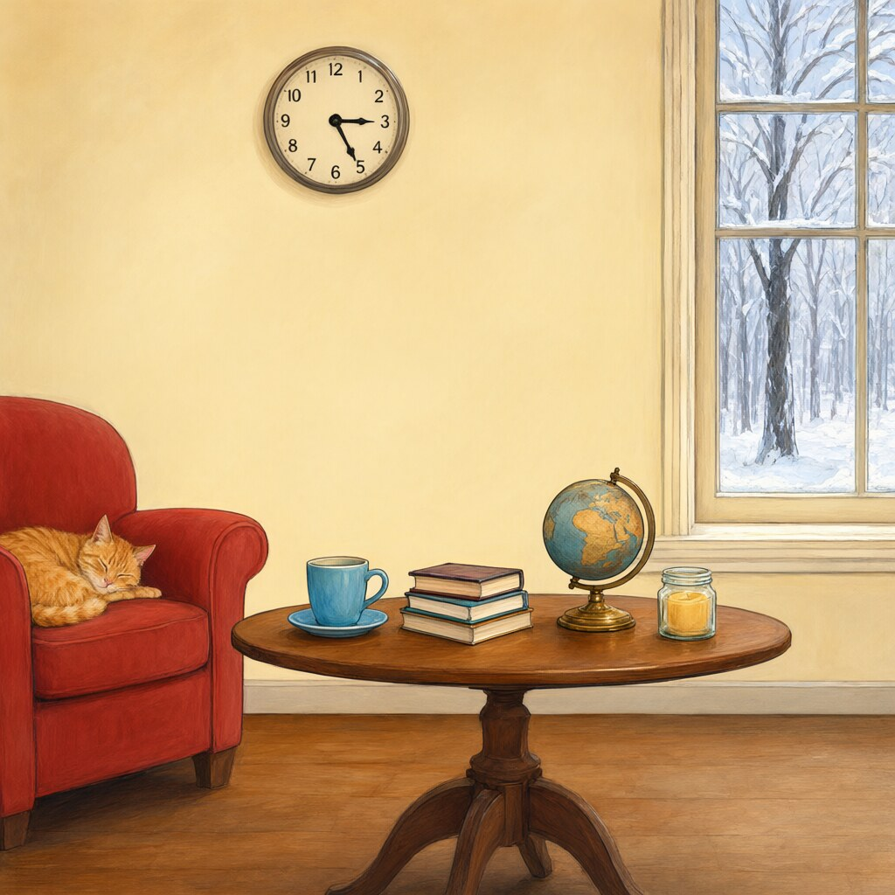
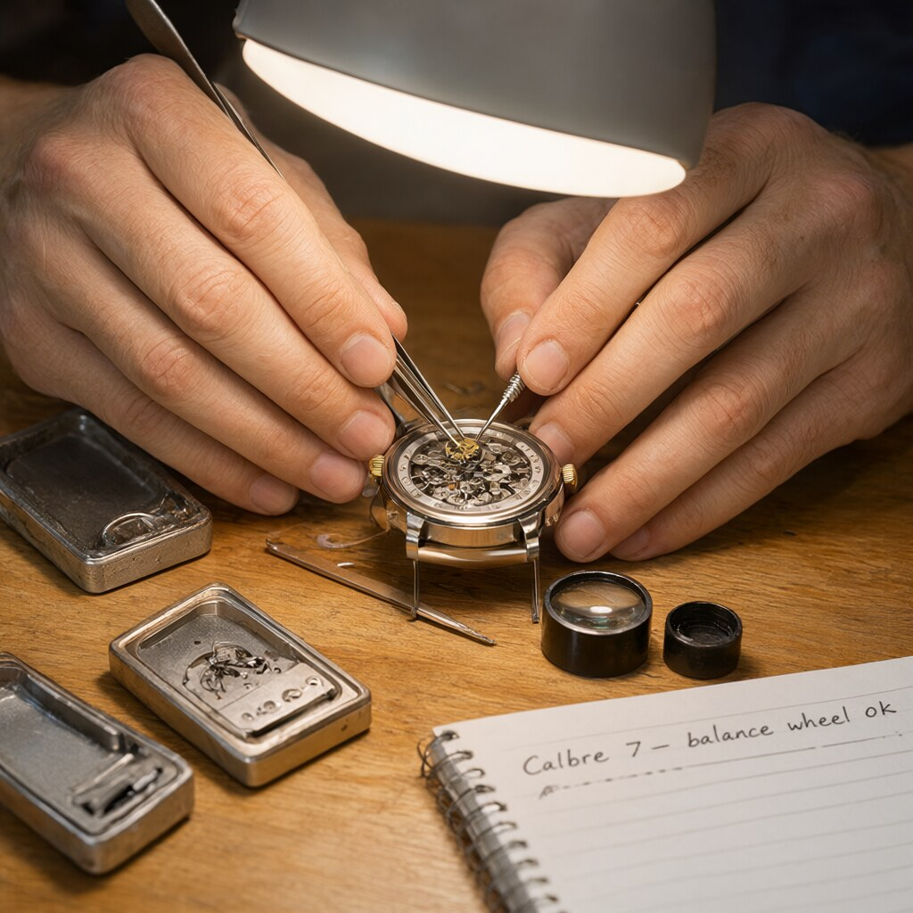

# Génération d'images : Qwen-Image-2.1 dans ComfyUI

Ce document décrit comment générer des images sur AiBeast avec **Qwen-Image-2.1** (7 milliards de paramètres, génération et retouche d'images), ce qui a été installé, ce que ça donne et les pièges rencontrés. Mesures du 21 octobre 2026. Pour les chiffres de performance, voir aussi [performance.md](performance.md) (§ 1 ter).

## En bref

- Lancer : `lab mode images`, puis ouvrir `http://127.0.0.1:8188` (tunnel SSH ouvert). Revenir aux modèles de langage : `lab mode normal`.
- Modèle utilisé : version **BF16 au format GGUF** d'une publication « sans filtre de contenu » (`abenzerps/Qwen-Image-2.1-Uncensored-Quantized`), qui reprend les poids d'origine de Qwen-Image-2.1.
- Résultat mesuré : **≈ 32,5 s par image** en 1024×1024 (25 étapes), VRAM presque pleine (23,3 Go sur 24).
- Les fichiers de modèles sont sur le grand disque (`/data/comfyui/models`).

## Ce qui est installé

| Élément | Détail |
|---|---|
| ComfyUI | Version 0.39.0 (image Docker communautaire `clsferguson/comfyui-docker`), PyTorch 2.14.1+cu130. Il faut au moins la 0.37.0 pour ce modèle |
| Nœud GGUF | `leejet/ComfyUI-GGUF`, cloné dans `/app/ComfyUI/custom_nodes/` (volume `comfyui_nodes`, donc conservé). La fiche du modèle recommande ce fork : l'ancienne version de city96 peut afficher « Unknown model architecture! » |
| Modèle de diffusion | `diffusion_models/qwen-image-2.1-UC-BF16.gguf` (14,2 Go) |
| Encodeur de texte | `text_encoders/qwen3vl_8b_int8_convrot.safetensors` (9,35 Go ; la version BF16 pèse 17,5 Go) |
| VAE | `vae/qwen_image_2.1_vae_bf16.safetensors` (676 Mo) |
| Emplacement | `/data/comfyui/models`, avec un lien symbolique depuis `~/Documents/ai-lab/comfyui/data/models` : ComfyUI et `lab` ne voient aucune différence |

## Installation pas à pas (ce qui a été fait)

1. **Mettre les modèles sur le grand disque.** `/data` appartenait à root : `sudo mkdir -p /data/comfyui && sudo chown "$USER": /data/comfyui`. Puis déplacement du dossier `models` vers `/data/comfyui/models` et lien symbolique. Le `mv` n'a pas pu supprimer l'ancien dossier (son parent `data/` appartient à root) : `sudo rmdir models && sudo ln -s /data/comfyui/models models`.
2. **Télécharger les trois fichiers** depuis Hugging Face avec `curl -fLC -` (reprise possible). Vérification des statuts avec `curl -fsIL … | grep HTTP` : `302` puis `200` (la redirection `302` est normale).
3. **Vérifier l'intégrité** avec `sha256sum` et la liste `SHA256SUMS` du dépôt. Les trois fichiers correspondent.
4. **Installer le nœud GGUF** : `docker exec comfyui git clone https://github.com/leejet/ComfyUI-GGUF /app/ComfyUI/custom_nodes/ComfyUI-GGUF`, `docker exec comfyui pip install --upgrade gguf`, `docker restart comfyui`. Les journaux montrent `ComfyUI-GGUF: Allowing full torch compile` : le nœud est chargé.
5. **Adapter le workflow.** Ouvrir le template *Qwen-Image-2.1* (Workflow, Parcourir les modèles). Le template regroupe les chargeurs dans un sous-graphe « Text to Image (Qwen Image 2.1) » : un nœud GGUF posé à l'extérieur ne peut pas s'y brancher. Il faut entrer dans le sous-graphe (icône en haut à droite du bloc) et y remplacer le chargeur du modèle de diffusion par **Unet Loader (GGUF)**.
6. **Régler** `clip_name` sur l'encodeur INT8, `vae_name` sur le VAE BF16, et laisser `refine_prompt` à `false`.
7. **Corriger l'erreur Triton** (voir le tableau des problèmes plus bas).

## Réglages utilisés

1024×1024 (`aspect_ratio` 1:1, `megapixels` 1,0, `multiple` 8), 25 étapes (`steps`), `cfg` 1,0, `sampler` `euler`, `scheduler` `simple`, `refine_prompt` et `thinking_mode` désactivés, `max_length` 4096, `cache_device` `auto`, `dtype` `default`. Ce sont ceux du template.

Pour comparer deux essais proprement : garde la même graine (`seed`), la même résolution, et ne change qu'un réglage à la fois.

## Mesures

| Essai | Durée |
|---|---|
| Prompt par défaut du template (première génération, charge les modèles) | 42,55 s |
| Test 1, ruelle de ramen (modèles déjà chargés) | 32,66 s |
| Test 2, horloger | 32,39 s |
| Test 3, bibliothèque | 32,42 s |
| Test 3 relancé après vidage des modèles et du cache | 37,82 s |

- **Régime établi ≈ 32,5 s** par image, soit ≈ 1,3 s par étape (encodage du texte et VAE compris).
- **Chargement des modèles : ≈ 5 s** (rechargement) à ≈ 10 s (première image).
- **VRAM** pendant la génération : 23 347 Mio sur 24 576 Mio, dont 22 682 Mio pour ComfyUI et ≈ 600 Mio pour le bureau. GPU à 100 %, 298 W sur 300 W, 53 °C. Ces 22,7 Go ne sont pas le besoin réel du modèle (14,2 Go) : ComfyUI occupe la VRAM libre pour garder des données en cache.

## Exemples

Les images sont dans `docs/images/qwen-image-2.1/` (1024×1024, converties en JPEG pour alléger). Les originaux en PNG (`Default_prompt.png`, `Test_1.png`, `Test_2.png`, `Test_3.png`) sont à la racine de `docs/`. Correspondance : Test 1 = ruelle de ramen, Test 2 = horloger, Test 3 = bibliothèque.

### 1. Portrait mode (prompt par défaut du template)


Prompt : « Greyscale fashion editorial portrait of an avant-garde woman tilted upwards in profile, captured with striking high-contrast chiaroscuro lighting. She wears oversized, thick-rimmed circular black sunglasses […] disrupted optical camouflage pattern […] pleated webbing and tailored cargo straps […] structured matte-leather geometric handbag […] vivid mixed-media graphic collage, flat vibrant lime green planes, stark black and white overlapping circles, segmented semi-circles with bold zebra striping, dense micro-halftone dot matrices, and vector topographic contour lines […] Absolutely no text, no typography, no letters, no words, no numbers, no logos, no watermark, no captions, pure imagery only. » (prompt complet dans le template ComfyUI.)

Verdict : très fidèle, tous les éléments demandés sont présents, aucun texte parasite.

### 2. Bibliothèque : relations spatiales et horloge



```
A cozy library interior. On the left, a red armchair with a sleeping orange tabby cat. In the center, a round wooden table with exactly four items from left to right: a blue teacup, a stack of three books, a brass globe, and a candle in a glass jar. On the right, a tall window showing a snowy forest. Above the table hangs a clock showing exactly 3:45. Soft painterly illustration style.
```

Verdict : composition et ordre des objets corrects. **L'horloge est fausse** : elle indique environ 3 h 25 au lieu de 3 h 45.

### 3. Horloger : mains, objets, texte manuscrit



```
Close-up of a watchmaker's hands assembling a mechanical watch under a bright desk lamp. Both hands are visible with exactly five fingers each: the left hand holds tweezers with a tiny gear, the right hand holds a screwdriver. On the wooden bench: three open watch cases, a magnifying loupe, and a small notebook with handwritten notes reading "Calibre 7 – balance wheel OK". Macro photography, very sharp focus, warm light.
```

Verdict : mains crédibles, trois boîtiers, loupe, pince et tournevis corrects. Le texte du carnet est approximatif (il semble manquer un « i » à « Calibre » et « ok » est en minuscules ; à confirmer en zoom).

### 4. Ruelle de ramen : texte, reflets, plusieurs sujets


```
A rainy night in a narrow Tokyo alley, seen from street level. A small ramen shop with a glowing red paper lantern reading "RAMEN" and a wooden sign below it reading "OPEN 24H – CLOSED MONDAYS". A chef with a white headband is visible through the steamy window, holding a bowl. Puddles on the ground reflect the neon signs upside down, and the reflection of the lantern shows the mirrored text correctly. A black cat sits on a green bicycle in the foreground, looking at the camera. Cinematic lighting, shallow depth of field, 35mm photograph.
```

Verdict : enseigne « OPEN 24H – CLOSED MONDAYS » parfaite, cuisinier et reflet de la lanterne réussis. Le dernier caractère de la lanterne est déformé, et le **chat n'est pas sur le vélo** (le vélo est au fond, le chat au premier plan et il ne regarde pas l'objectif).

## Ce que le modèle fait bien et moins bien

- **Bien** : prompts longs et très descriptifs, compositions chargées, texte court en gros caractères, éclairage, matières.
- **Moins bien** : l'heure sur un cadran, le texte manuscrit de petite taille, le placement précis d'un objet (« le chat *sur* le vélo »), les détails numériques fins.
- **Astuces** : une instruction de placement par phrase courte ; changer la graine suffit souvent à corriger une erreur ponctuelle ; ne pas compter sur une heure précise.

## Problèmes rencontrés et solutions

| Symptôme | Cause | Solution |
|---|---|---|
| `mkdir: Permission denied` sur `/data/comfyui` | `/data` appartient à root | `sudo mkdir -p /data/comfyui && sudo chown "$USER": /data/comfyui` |
| `mv` : « impossible de supprimer 'models' » | Le dossier parent `comfyui/data/` appartient à root | Les fichiers sont bien déplacés ; `sudo rmdir models` puis `sudo ln -s /data/comfyui/models models` |
| `curl -fIL … \| head -3` n'affiche que `302` | `head` coupe la chaîne de redirections | `curl -fsIL … \| grep -i '^HTTP'` : on attend `302` puis `200` |
| `sha256sum -c` sans argument ne rend pas la main | Il lit l'entrée standard | Ctrl-C, puis `sha256sum -c fichier.sha256` |
| `unet_name` : « No Results Found » | Le chargeur standard du template ne liste que les `.safetensors` de `diffusion_models/` ; un `.gguf` n'y apparaît pas | Remplacer le chargeur par **Unet Loader (GGUF)** |
| Le nœud GGUF posé hors du bloc n'est branché sur rien | Le template regroupe les chargeurs dans un sous-graphe | Entrer dans le sous-graphe et y remplacer le chargeur |
| `PermissionError: /root/.triton` (nœud `TextEncodeQwenImage21`) | Triton écrit son cache dans `/root/.triton`, inaccessible à l'utilisateur du conteneur | Contournement : `docker exec comfyui bash -c "mkdir -p /root/.triton && chmod 1777 /root/.triton && chmod o+x /root"`. Perdu si le conteneur est recréé. Correction durable à faire : variable `TRITON_CACHE_DIR` dans `comfyui/docker-compose.yml` |
| Erreurs `sageattention` au démarrage (`CUDA mismatch 12.8 / 13.0`) | L'image tente de compiler un composant d'accélération optionnel | Sans conséquence ; ComfyUI démarre et la génération fonctionne |
| `PE_model` réglé sur l'encodeur de texte | Le seul fichier compatible trouvé par ComfyUI ; le vrai fichier du « prompt enhancer » n'est pas téléchargé | Laisser `refine_prompt` sur `false` |

## Alternatives si la VRAM manque ou si tu veux comparer

- **Q8_0 GGUF** (7,6 Go) : qualité très proche du BF16 pour moitié moins de mémoire.
- **INT8 `convrot` en `.safetensors`** (7,3 Go, fichier `qwen-image-2.1-UC-int8_convrot.safetensors` du même dépôt) : se charge avec le nœud standard, sans le sous-graphe modifié.
- **Version officielle** : dépôt `Comfy-Org/Qwen-Image-2.1` (121 Go au total, avec les versions BF16 et INT8). Le template de ComfyUI propose le téléchargement des fichiers manquants.
- Arrêter le bureau à distance (`lab bureau off`) libère ≈ 600 Mio.

## Installation durable (21 octobre 2026)

Les deux corrections faites à la main dans le conteneur (droits sur `/root/.triton`, paquet `gguf`) disparaissent
si le conteneur est recréé. Elles sont remplacées par `comfyui/docker-compose.yml` :

- **Triton** : ComfyUI tourne sous `appuser`, lancé par `runuser -p`, qui garde `HOME=/root` ; Triton écrivait donc
  dans `/root/.triton`. `TRITON_CACHE_DIR` et `TRITON_HOME` pointent vers `/tmp/triton` (cache perdu à la recréation,
  reconstruit tout seul).
- **gguf** : l'image n'installe les `requirements.txt` des nœuds qu'au premier démarrage (fichier témoin
  `.first_run_done`) ; ComfyUI-GGUF a été ajouté après. `COMFY_FORCE_INSTALL: "1"` les revérifie à chaque démarrage
  (`pip` en mode « seulement si nécessaire » : rien n'est téléchargé si `gguf` est présent).
- **Image figée** par son empreinte (`ghcr.io/clsferguson/comfyui-docker@sha256:6c0adbc0…`, version du 6 octobre 2026) :
  `lab update` ne change plus ComfyUI. Pour mettre à jour : `docker pull ghcr.io/clsferguson/comfyui-docker:latest`,
  relever l'empreinte (`docker image inspect -f '{{index .RepoDigests 0}}' …`), la reporter dans le compose, recréer,
  refaire une génération d'essai. ComfyUI-Manager, lui, est toujours mis à jour par l'image à chaque démarrage.

**Testé le 21 octobre 2026** : conteneur recréé (`docker compose up -d` dans `comfyui/`) sans aucune correction à la main ;
`gguf` réinstallé automatiquement (`gguf-0.19.0`), génération Qwen-Image-2.1 réussie en 31,98 s.
**Démarrage après une recréation : ≈ 6 min**, presque entièrement dues à l'étape « Setting up user permissions » de l'image
(`chown -R`/`chmod -R` sur tout `site-packages`). Un fichier témoin (`PERMISSIONS_SET_FLAG`) devrait l'éviter aux démarrages
suivants (non vérifié). La compilation de SageAttention échoue à chaque démarrage (avertissement, sans conséquence : option non utilisée).

## Licence et usage

- Licence **Qwen Research License** : relis ses conditions avant tout usage commercial.
- Cette publication n'a **aucun filtre de contenu** : elle peut produire des images adultes ou sensibles. ComfyUI n'écoute que sur `127.0.0.1` ; ne l'expose pas à d'autres personnes (par exemple via Open WebUI) sans y avoir réfléchi.

## Ce qui n'est pas vérifié

- Après la recréation du 21 octobre, une seule génération a été mesurée (31,98 s) : impossible de dire si les modèles étaient déjà chargés.

- Les **temps par étape isolés**, les résolutions supérieures à 1 mégapixel, un nombre d'étapes différent, et la comparaison BF16 / Q8_0 / INT8 (vitesse, qualité, VRAM) n'ont pas été mesurés.
- Je ne sais pas ce que « vider le cache » a vidé exactement, ni pourquoi la première image est plus lente que le rechargement (≈ 10 s contre ≈ 5 s).
- La **correction durable de Triton** n'est pas appliquée. Après une recréation du conteneur, il faudra aussi refaire `pip install gguf` (le paquet est dans la couche du conteneur, pas dans un volume), ou vérifier que l'image le réinstalle.
- Le nœud `leejet/ComfyUI-GGUF` gère ce modèle d'après la fiche du modèle ; son README ne mentionne pas Qwen-Image-2.1. Cela fonctionne ici, sans garantie pour les versions futures.
- L'intégration dans **Open WebUI** (génération d'images depuis le chat avec ce modèle) n'est pas faite.
- Texte du carnet sur l'image de l'horloger : lecture faite sur une image réduite, à confirmer en zoom.
