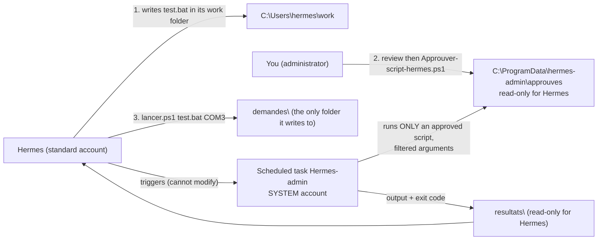

# Hermes: SSH access to a test machine

So that Hermes can deploy and run code on a test machine (a VM or a PC of yours), without giving it your own keys or
broad access.

## Principle

- **One key per machine**, created for Hermes (`hermes@aibeast-NAME`), valid only on that machine.
- **A dedicated user** on the machine, without `sudo`, who only sees their own folder. The worst case is therefore
  limited to that user and to what it can reach over the network.
- **Machine fingerprint pinned** (`StrictHostKeyChecking yes`): it is checked once, at creation.
- **Key restricted on the machine side**: `restrict,pty,from="AiBeast's address"`: no port forwarding, no SSH agent,
  connection only accepted from the AI machine.
- The agent is only given the command `ssh -F /opt/data/ssh/config NAME …` (rule written in the `AGENTS.md` of new
  projects).

## Setup

On the AI machine:

```
lab remote add NAME hermes@MACHINE_ADDRESS   # add --windows for a Windows PC
```

1. The command shows the fingerprint presented by the machine. On the machine, type
   `ssh-keygen -lf /etc/ssh/ssh_host_ed25519_key.pub` and compare. Answer `y` if they are identical.
2. It creates the key in `hermes/data/ssh/` and shows **4 commands to type on the machine** (creating the user and
   `authorized_keys`).
3. `lab remote test NAME` tries the connection **from the Hermes container** and reports whether the user has `sudo`
   (it should not).
4. For an **existing** project (for example `my_project`): `lab remote link NAME my_project` adds the rules for using
   the machine to its `AGENTS.md` (without touching the rest of the file) and shows the sentence to say to Hermes.

`lab remote show NAME [--windows]` shows again what to do on the machine, with your key already in it (useful if you
lost the output or a step failed).

Other commands: `lab remote list`, `lab remote remove NAME`.

New projects get these rules at creation; for older ones, use `lab remote link`.

## If the machine is a Windows PC

Add `--windows`: `lab remote add NAME hermes@ADDRESS --windows`. Instead of Linux commands, the command shows a
**PowerShell block to run as administrator on the PC**: installs the OpenSSH server, creates a `hermes` user who is a
plain user (not an administrator, unknown random password), key stored outside its profile, key-only login for that
account. Fingerprint to compare: `ssh-keygen -lf C:\ProgramData\ssh\ssh_host_ed25519_key.pub`.

Good to know on Windows:
- The remote shell is `cmd.exe`; Hermes runs `powershell -NoProfile -Command "…"` for the rest (it is written in its
  rules).
- Tools installed in **your** profile (Python, PlatformIO, Arduino…) are invisible to `hermes`: install them for all
  users.
- If the PC is **your main PC**, the dedicated user does not see your profile, but it does see shared folders
  (`C:\Users\Public`, drives without restrictions). Put the working files in its `work\<project>` folder and check what
  it can read before trusting it with anything.
- The Windows firewall can restrict SSH access to the AI machine's address:
  `Set-NetFirewallRule -Name OpenSSH-Server-In-TCP -RemoteAddress AIBEAST_ADDRESS`.
- The AI machine must **reach** the PC (same network, or a VPN in both directions): `ping -c 2 ADDRESS` from the AI
  machine.

## Administrator scripts (Windows machine)

The agent is **never** an administrator of the test machine: otherwise it could disable the firewall that cuts the
Internet or re-enable SSH tunnels ([agent-isolation.md](agent-isolation.md) §5). For the `.bat`/`.cmd` scripts that
must run as administrator, it goes through **scripts you have approved**:



The folders keep their original names on the machine: `approuves` = approved, `demandes` = requests, `resultats` =
results, `outils` = tools; `lancer.ps1` = run.

**Installation** (once, on the test machine, PowerShell as administrator, files copied from `windows\outils\`):

```powershell
powershell -ExecutionPolicy Bypass -File .\Installer-admin-hermes.ps1              # account: hermes
powershell -ExecutionPolicy Bypass -File .\Installer-admin-hermes.ps1 -Uninstall   # remove everything
```

**Approving a script** (for every new script or new version): the script is shown in full, sensitive lines are flagged
(firewall, SSH, accounts, rights, tasks, services, registry, downloads, files the agent can modify), then you must type
`yes`.

```powershell
powershell -ExecutionPolicy Bypass -File .\Approuver-script-hermes.ps1 -Script C:\Users\hermes\work\project\test.bat
powershell -ExecutionPolicy Bypass -File .\Approuver-script-hermes.ps1 -List        # approved scripts (hash)
powershell -ExecutionPolicy Bypass -File .\Approuver-script-hermes.ps1 -Remove test.bat
powershell -ExecutionPolicy Bypass -File .\Approuver-script-hermes.ps1 -Log         # latest runs
```

What to check when reviewing: the script must only call **files placed next to it** (`%~dp0`) or system programs,
never a file in the agent's profile (it could change it after your approval), and must not touch the firewall, SSH,
accounts or `C:\ProgramData\hermes-admin`. What is approved runs with **SYSTEM** rights.

**On the agent side**: rule 6 of its `AGENTS.md` (`hermes/dev-template/AGENTS.md`). History: `approbations.log` and
`resultats\journal.log` in `C:\ProgramData\hermes-admin`. Maximum duration of a run: 1 hour.

Seen on the reference Windows machine: installation, approval of a test script and launch by Hermes work; Hermes stays
a standard account.

## Good practice

- **Isolation**: Hermes has no network access except those you allow. Add the machine's address to
  `LAB_AGENT_SSH_ALLOW` in `lab.conf`, then `lab isolation apply`: otherwise the SSH connection is blocked
  ([agent-isolation.md](agent-isolation.md)).
- **Never an administrator**: for scripts that need it, see "Administrator scripts" above.
- **No Internet through the test machine**: run `windows\outils\Isoler-machine-de-test.ps1` as administrator on the
  machine (Internet and DNS cut for the whole machine, SSH tunnels forbidden for Hermes's account), then
  `lab remote test NAME` (section 5 of [agent-isolation.md](agent-isolation.md)).
- **Take a snapshot of the VM** before each session: the agent can break the machine, by mistake or because something
  it read pushed it to.
- **Use a machine without secrets**: no tokens, no keys to other machines, no mounted network shares, and if possible
  isolated from your sensitive network. Hermes can only reach what the machine reaches.
- If the tests need packages installed, install them yourself beforehand; do not give `sudo` to the user. If it is
  essential, a `sudoers` rule limited to one precise command is better than full `sudo`.
- This access is **on demand**: Hermes only runs when you start it. If you no longer need it, `lab remote remove NAME`
  then remove the key on the machine.

## Limits

- **Hermes reads the key**: it is in its data folder, it must be able to use it. If a malicious text manipulates it, it
  can use the key on that machine, hence the user without rights. It cannot send the key out: its container has no
  Internet access (`lab isolation`), and neither has the test machine once isolated.
- The firewall of the AI machine only lets Hermes reach the addresses in `LAB_AGENT_SSH_ALLOW`; other machines on your
  local network are blocked.
- The rules in `AGENTS.md` guide the agent, they do not force it.

## Lessons learned: from creation to the first successful test

Real setup on a Windows test PC (`pc-test`, project `my_project`, Hermes has to send I²C commands to it). Final result:
`lab remote test pc-test` succeeds, with a `hermes` user without administrator rights or `sudo`. Here, in order, is what
caused problems, and the solution.

### On the AI machine

| Symptom | Cause | Solution |
|---|---|---|
| `lab remote test`: "No user exists for uid 1000" | `ssh` refuses to run if the container's user id has no entry in `/etc/passwd` (container started with `--entrypoint bash`) | The test mounts a copy of `/etc/passwd` with that entry added |
| `lab remote test` hangs after the last line | `ssh` waits for standard input | `ssh -n` and `< /dev/null` in the test |
| `lab remote add` refuses: "already exists" | A machine with the same name is already registered | `lab remote remove NAME`, then `add`. **Careful: a new key is then generated.** The key shown by `lab remote show NAME --windows` therefore changes after a `remove`/`add`, and the one already pasted on the PC no longer works: paste the block shown by `show` again |

### On the Windows PC

| Symptom | Cause | Solution |
|---|---|---|
| `ssh-keygen -lf /etc/ssh/ssh_host_ed25519_key.pub`: file not found | Linux path | `ssh-keygen -lf C:\ProgramData\ssh\ssh_host_ed25519_key.pub` |
| "unexpected newguid" | `[guid]::NewGuid()` badly pasted into the terminal | `(New-Guid).ToString('N')` |
| `icacls`: "invalid parameter /inheritancer" | Typo (missing `:`) | `/inheritance:r` |
| "the system cannot find the specified file" | User name: the help showed `hermes-test` whereas the account created is called `hermes` | Use the same name everywhere: `hermes` |
| "Access denied" when editing the key file | PowerShell not run as administrator, or file owned by another account | Run PowerShell **as administrator**; if needed `takeown /f $f` |
| `Permission denied (publickey,password,keyboard-interactive)` on the AI machine side, although everything looked right | See below | See below |

**Final cause of the key refusal.** The PC's log (`Get-WinEvent -LogName OpenSSH/Operational -MaxEvents 20`) said:

```
Authentication refused: bad ownership or modes for file C:\ProgramData\ssh\hermes_authorized_keys
Bad permissions … Administrator
```

With `StrictModes yes` (the default), `sshd` refuses a key file whose access list contains an account other than:
`SYSTEM`, the Administrators group and the user concerned. An **`Administrator`** entry (the account, not the group)
was there. The log is the only place where this cause appears: on the AI machine side you only see "Permission denied".

Fix:

```
icacls $f /remove 'Administrator'
icacls $f /grant 'hermes:R'
icacls $f
```

`icacls $f` must only list `SYSTEM`, `Administrators` and `hermes`. Then `Restart-Service sshd`.

**Leads that are not the cause** (so as not to spend time on them again):
- The line `AuthorizedKeysFile C:/ProgramData/ssh/administrators_authorized_keys` seen in `sshd -T` comes from Windows's
  `Match Group administrators` block. It does not concern a user who is not an administrator.
- `sshd -T` alone shows "ga_init, unable to resolve user hermes": the command must be given the user, for example
  `sshd -T -C user=hermes,host=x,addr=x`.
- The `DEBUG3` log level in `sshd_config` was used for the diagnosis and is not to be left on.

### Diagnostic commands to keep

On the AI machine:

```
lab remote test NAME
ssh -v -F hermes/data/ssh/config NAME       # detailed client-side trace
```

On the PC (PowerShell as administrator):

```
Get-WinEvent -LogName OpenSSH/Operational -MaxEvents 20 | Format-List TimeCreated,Message
icacls C:\ProgramData\ssh\hermes_authorized_keys
Get-Service sshd
```

### After a reboot of the PC

The service is set to start automatically (`Set-Service sshd -StartupType Automatic`): the connection comes back by
itself. Only condition: **the PC keeps the same IP address**. If it changes, `lab remote remove` then `add` with the new
address, or reserve the address in the router.

### Clean-up after the diagnosis

If the log level was raised to look for the fault, restore the original configuration:

```
Copy-Item C:\ProgramData\ssh\sshd_config.bak C:\ProgramData\ssh\sshd_config -Force
Restart-Service sshd
```

(with the backup you took; then check that the `Match User hermes` line is still there, otherwise
`lab remote show NAME --windows` gives it again).

## What remains to be verified

- **`lab remote link NAME PROJECT`** (adds the rules to the project's `AGENTS.md`) has been confirmed with the old
  French marker; the English version accepts both markers (tested by `scripts/test-remote.sh`).
- **No safeguard on the I²C commands.** Hermes can send whatever it wants to the bus with `hermes`'s rights. A wrapper
  script limiting addresses and commands would be a next step.
- **Source address `from="…"`**: deduced from the AI machine's route to the machine. With a VPN or NAT, the PC may see
  another address; then remove `from=` or correct it.
- `lab remote link` refuses a project or an `AGENTS.md` that is a symbolic link (tested).
- The automated tests (`scripts/test-remote.sh`) use a **simulated `ssh-keygen`**: they check name validation (against
  injection into the ssh config), file permissions, pinning and removal. The real connection was validated by hand, as
  described above.
