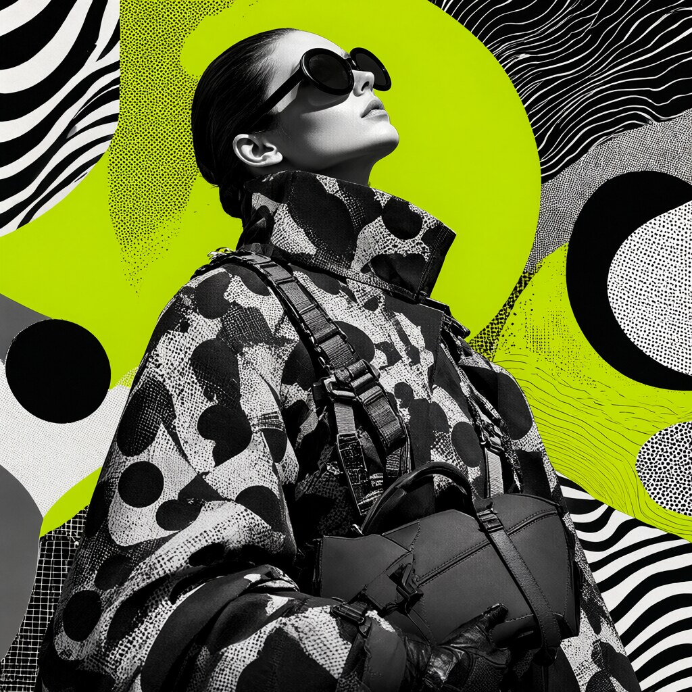

# Image generation: Qwen-Image-2.1 in ComfyUI

This document describes how to generate images on the AI machine with **Qwen-Image-2.1** (7 billion parameters, image
generation and editing), what was installed, what it gives and the pitfalls met. Measurements made on the reference
machine. For the performance figures, see also [performance.md](performance.md) (§ 1c).

## In short

- Start: `lab mode images`, then open `http://127.0.0.1:8188` (SSH tunnel open). Back to the language models:
  `lab mode normal`.
- Model used: **BF16 version in GGUF format** of a release "without a content filter"
  (`abenzerps/Qwen-Image-2.1-Uncensored-Quantized`), which reuses the original Qwen-Image-2.1 weights.
- Measured result: **≈ 32.5 s per image** at 1024×1024 (25 steps), VRAM almost full (23.3 GB out of 24).
- The model files are on the large disk (`/data/comfyui/models`).

## What is installed

| Item | Detail |
|---|---|
| ComfyUI | Version 0.39.0 (community Docker image `clsferguson/comfyui-docker`), PyTorch 2.14.1+cu130. At least 0.37.0 is needed for this model |
| GGUF node | `leejet/ComfyUI-GGUF`, cloned into `/app/ComfyUI/custom_nodes/` (`comfyui_nodes` volume, so kept). The model card recommends this fork: the older city96 version can show "Unknown model architecture!" |
| Diffusion model | `diffusion_models/qwen-image-2.1-UC-BF16.gguf` (14.2 GB) |
| Text encoder | `text_encoders/qwen3vl_8b_int8_convrot.safetensors` (9.35 GB; the BF16 version weighs 17.5 GB) |
| VAE | `vae/qwen_image_2.1_vae_bf16.safetensors` (676 MB) |
| Location | `/data/comfyui/models`, with a symbolic link from `~/Documents/ai-lab/comfyui/data/models`: ComfyUI and `lab` see no difference |

## Step-by-step installation (what was done)

1. **Put the models on the large disk.** `/data` belonged to root: `sudo mkdir -p /data/comfyui && sudo chown "$USER": /data/comfyui`.
   Then move the `models` folder to `/data/comfyui/models` and create a symbolic link. The `mv` could not delete the old
   folder (its parent `data/` belongs to root): `sudo rmdir models && sudo ln -s /data/comfyui/models models`.
2. **Download the three files** from Hugging Face with `curl -fLC -` (resumable). Check the statuses with
   `curl -fsIL … | grep HTTP`: `302` then `200` (the `302` redirect is normal).
3. **Check integrity** with `sha256sum` and the repository's `SHA256SUMS` list. The three files match.
4. **Install the GGUF node**: `docker exec comfyui git clone https://github.com/leejet/ComfyUI-GGUF /app/ComfyUI/custom_nodes/ComfyUI-GGUF`,
   `docker exec comfyui pip install --upgrade gguf`, `docker restart comfyui`. The logs show
   `ComfyUI-GGUF: Allowing full torch compile`: the node is loaded.
5. **Adapt the workflow.** Open the *Qwen-Image-2.1* template (Workflow, Browse templates). The template groups the
   loaders in a "Text to Image (Qwen Image 2.1)" subgraph: a GGUF node placed outside cannot be wired into it. You have
   to enter the subgraph (icon at the top right of the block) and replace the diffusion model loader with
   **Unet Loader (GGUF)** there.
6. **Set** `clip_name` to the INT8 encoder, `vae_name` to the BF16 VAE, and leave `refine_prompt` at `false`.
7. **Fix the Triton error** (see the problems table below; now handled by the compose file).

## Settings used

1024×1024 (`aspect_ratio` 1:1, `megapixels` 1.0, `multiple` 8), 25 steps (`steps`), `cfg` 1.0, `sampler` `euler`,
`scheduler` `simple`, `refine_prompt` and `thinking_mode` disabled, `max_length` 4096, `cache_device` `auto`, `dtype`
`default`. These are the template's settings.

To compare two trials properly: keep the same seed (`seed`), the same resolution, and change only one setting at a time.

## Measurements

| Trial | Duration |
|---|---|
| Template's default prompt (first generation, loads the models) | 42.55 s |
| Test 1, ramen alley (models already loaded) | 32.66 s |
| Test 2, watchmaker | 32.39 s |
| Test 3, library | 32.42 s |
| Test 3 run again after unloading the models and the cache | 37.82 s |

- **Steady state ≈ 32.5 s** per image, i.e. ≈ 1.3 s per step (text encoding and VAE included).
- **Model loading: ≈ 5 s** (reload) to ≈ 10 s (first image).
- **VRAM** during generation: 23,347 MiB out of 24,576 MiB, of which 22,682 MiB for ComfyUI and ≈ 600 MiB for the
  desktop. GPU at 100 %, 298 W out of 300 W, 53 °C. These 22.7 GB are not the model's real need (14.2 GB): ComfyUI takes
  the free VRAM to keep data cached.

## Examples

The images are in `docs/images/qwen-image-2.1/` (1024×1024, converted to JPEG to keep them light). Test 1 = ramen
alley, Test 2 = watchmaker, Test 3 = library.

### 1. Fashion portrait (template's default prompt)



Prompt: "Greyscale fashion editorial portrait of an avant-garde woman tilted upwards in profile, captured with striking
high-contrast chiaroscuro lighting. She wears oversized, thick-rimmed circular black sunglasses […] disrupted optical
camouflage pattern […] pleated webbing and tailored cargo straps […] structured matte-leather geometric handbag […]
vivid mixed-media graphic collage, flat vibrant lime green planes, stark black and white overlapping circles, segmented
semi-circles with bold zebra striping, dense micro-halftone dot matrices, and vector topographic contour lines […]
Absolutely no text, no typography, no letters, no words, no numbers, no logos, no watermark, no captions, pure imagery
only." (full prompt in the ComfyUI template.)

Verdict: very faithful, every requested element is present, no stray text.

### 2. Library: spatial relations and a clock


```
A cozy library interior. On the left, a red armchair with a sleeping orange tabby cat. In the center, a round wooden table with exactly four items from left to right: a blue teacup, a stack of three books, a brass globe, and a candle in a glass jar. On the right, a tall window showing a snowy forest. Above the table hangs a clock showing exactly 3:45. Soft painterly illustration style.
```

Verdict: composition and order of the objects correct. **The clock is wrong**: it shows about 3:25 instead of 3:45.

### 3. Watchmaker: hands, objects, handwritten text


```
Close-up of a watchmaker's hands assembling a mechanical watch under a bright desk lamp. Both hands are visible with exactly five fingers each: the left hand holds tweezers with a tiny gear, the right hand holds a screwdriver. On the wooden bench: three open watch cases, a magnifying loupe, and a small notebook with handwritten notes reading "Calibre 7 – balance wheel OK". Macro photography, very sharp focus, warm light.
```

Verdict: believable hands, three cases, loupe, tweezers and screwdriver correct. The notebook text is approximate (an
"i" seems to be missing in "Calibre" and "ok" is lower-case; to confirm by zooming in).

### 4. Ramen alley: text, reflections, several subjects


```
A rainy night in a narrow Tokyo alley, seen from street level. A small ramen shop with a glowing red paper lantern reading "RAMEN" and a wooden sign below it reading "OPEN 24H – CLOSED MONDAYS". A chef with a white headband is visible through the steamy window, holding a bowl. Puddles on the ground reflect the neon signs upside down, and the reflection of the lantern shows the mirrored text correctly. A black cat sits on a green bicycle in the foreground, looking at the camera. Cinematic lighting, shallow depth of field, 35mm photograph.
```

Verdict: "OPEN 24H – CLOSED MONDAYS" sign perfect, chef and lantern reflection successful. The last character of the
lantern is distorted, and the **cat is not on the bicycle** (the bicycle is in the background, the cat in the
foreground and it does not look at the camera).

## What the model does well and less well

- **Well**: long, very descriptive prompts, busy compositions, short text in large characters, lighting, materials.
- **Less well**: the time on a clock face, small handwritten text, precise placement of an object ("the cat *on* the
  bicycle"), fine numeric details.
- **Tips**: one placement instruction per short sentence; changing the seed is often enough to fix a one-off error; do
  not count on a precise time.

## Problems met and solutions

| Symptom | Cause | Solution |
|---|---|---|
| `mkdir: Permission denied` on `/data/comfyui` | `/data` belongs to root | `sudo mkdir -p /data/comfyui && sudo chown "$USER": /data/comfyui` |
| `mv`: "cannot remove 'models'" | The parent folder `comfyui/data/` belongs to root | The files are moved; `sudo rmdir models` then `sudo ln -s /data/comfyui/models models` |
| `curl -fIL … \| head -3` only shows `302` | `head` cuts the chain of redirects | `curl -fsIL … \| grep -i '^HTTP'`: expect `302` then `200` |
| `sha256sum -c` without an argument does not return | It reads standard input | Ctrl-C, then `sha256sum -c file.sha256` |
| `unet_name`: "No Results Found" | The template's standard loader only lists the `.safetensors` files of `diffusion_models/`; a `.gguf` does not appear | Replace the loader with **Unet Loader (GGUF)** |
| The GGUF node placed outside the block is wired to nothing | The template groups the loaders in a subgraph | Enter the subgraph and replace the loader there |
| `PermissionError: /root/.triton` (node `TextEncodeQwenImage21`) | Triton writes its cache to `/root/.triton`, not accessible to the container's user | Fixed durably by `TRITON_CACHE_DIR` in `comfyui/docker-compose.yml` (see below). Former workaround: `docker exec comfyui bash -c "mkdir -p /root/.triton && chmod 1777 /root/.triton && chmod o+x /root"`, lost when the container is recreated |
| `sageattention` errors at startup (`CUDA mismatch 12.8 / 13.0`) | The image tries to build an optional acceleration component | No consequence; ComfyUI starts and generation works |
| `PE_model` set to the text encoder | The only compatible file found by ComfyUI; the actual "prompt enhancer" file is not downloaded | Leave `refine_prompt` at `false` |

## Alternatives if VRAM is short or to compare

- **Q8_0 GGUF** (7.6 GB): quality very close to BF16 for half the memory.
- **INT8 `convrot` as `.safetensors`** (7.3 GB, file `qwen-image-2.1-UC-int8_convrot.safetensors` from the same
  repository): loads with the standard node, without the modified subgraph.
- **Official version**: repository `Comfy-Org/Qwen-Image-2.1` (121 GB in total, with BF16 and INT8 versions). The
  ComfyUI template offers to download missing files.
- Stopping the remote desktop (`lab desktop off`) frees ≈ 600 MiB.

## Durable installation

The two fixes made by hand inside the container (rights on `/root/.triton`, `gguf` package) disappear if the container
is recreated. They are replaced by `comfyui/docker-compose.yml`:

- **Triton**: ComfyUI runs as `appuser`, started by `runuser -p`, which keeps `HOME=/root`; Triton therefore wrote to
  `/root/.triton`. `TRITON_CACHE_DIR` and `TRITON_HOME` point to `/tmp/triton` (cache lost on recreation, rebuilt by
  itself).
- **gguf**: the image only installs the nodes' `requirements.txt` at the first start (marker file `.first_run_done`);
  ComfyUI-GGUF was added afterwards. `COMFY_FORCE_INSTALL: "1"` checks them again at every start (`pip` in "only if
  needed" mode: nothing is downloaded if `gguf` is present).
- **Image pinned** by its digest (`ghcr.io/clsferguson/comfyui-docker@sha256:6c0adbc0…`): `lab update` no longer changes
  ComfyUI. To update: `docker pull ghcr.io/clsferguson/comfyui-docker:latest`, read the digest
  (`docker image inspect -f '{{index .RepoDigests 0}}' …`), put it in the compose file, recreate, run a test
  generation. ComfyUI-Manager, on the other hand, is always updated by the image at every start.

**Tested**: container recreated (`docker compose up -d` in `comfyui/`) without any manual fix; `gguf` reinstalled
automatically (`gguf-0.19.0`), Qwen-Image-2.1 generation successful in 31.98 s.
**Start after a recreation: ≈ 6 min**, almost entirely due to the image's "Setting up user permissions" step
(`chown -R`/`chmod -R` on the whole `site-packages`). A marker file (`PERMISSIONS_SET_FLAG`) should avoid it on the
following starts (not verified). The SageAttention build fails at every start (warning, no consequence: option not
used).

## License and use

- **Qwen Research License**: read its terms before any commercial use.
- This release has **no content filter**: it can produce adult or sensitive images. ComfyUI only listens on
  `127.0.0.1`; do not expose it to other people (for example through Open WebUI) without thinking about it.

## What is not verified

- After the recreation, a single generation was measured (31.98 s): impossible to say whether the models were already
  loaded.
- **Isolated per-step times**, resolutions above 1 megapixel, a different number of steps, and the BF16 / Q8_0 / INT8
  comparison (speed, quality, VRAM) were not measured.
- It is not known exactly what "clearing the cache" cleared, nor why the first image is slower than a reload (≈ 10 s
  versus ≈ 5 s).
- The `leejet/ComfyUI-GGUF` node handles this model according to the model card; its README does not mention
  Qwen-Image-2.1. It works here, with no guarantee for future versions.
- Integration into **Open WebUI** (image generation from the chat with this model) is not done.
- Notebook text on the watchmaker image: read on a reduced image, to confirm by zooming in.
