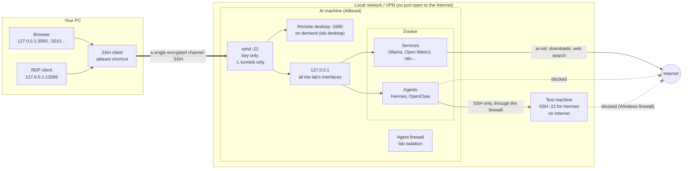
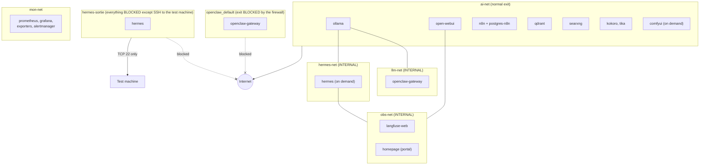
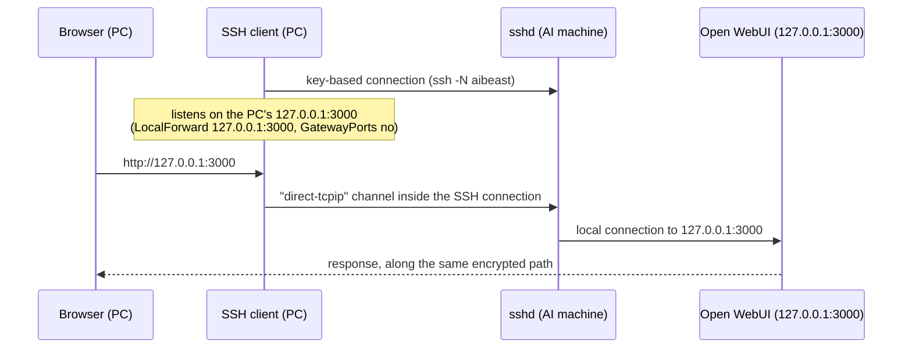
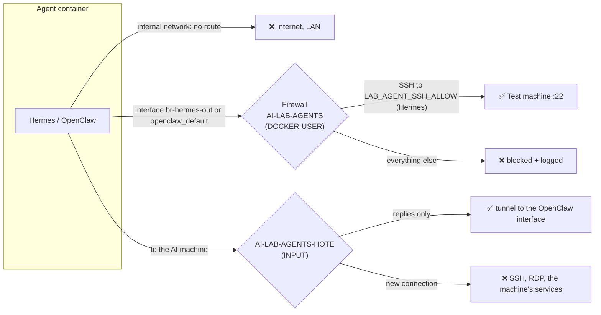
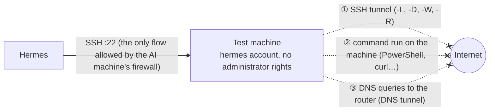

# Network and security architecture of the lab

This document describes **how the components of the lab communicate** and **which protections apply at each level**.
It is the entry point to understand security; the details of each mechanism are in the documents cited. Verified on the
reference machine (AiBeast: Ubuntu, Docker 29, iptables firewall).

Vocabulary: **the AI machine** (AiBeast) runs the whole lab; **your PC** is the computer you work from; **the test
machine** is a computer on the local network that the Hermes agent can connect to over SSH (for example a Windows PC
driving hardware).

## 1. Principles

1. **Nothing is exposed.** All the lab's interfaces listen on the AI machine's `127.0.0.1`. Only SSH (22) and, if
   enabled, the remote desktop (3389) listen on the network. No port is open to the Internet: access from outside goes
   through a VPN.
2. **SSH is the only way in**, key-only. Your PC runs tunnels to the interfaces through it.
3. **Each service only sees what it needs**: several separate Docker networks, three of which are "internal" with no
   exit at all.
4. **The agents (Hermes, OpenClaw) are confined**: no Internet, no local network, not the AI machine. They only talk to
   the local model. Single exception: SSH from Hermes to the test machine, itself deprived of the Internet.
5. **Defence in depth**: each protection is backed by another of a different kind (Docker network + firewall; key option
   + SSH server configuration; agent policy + no network route).
6. **Everything can be checked with a command**: `lab doctor`, `lab isolation test`, `lab remote test NAME` (§9).

## 2. Overview

## 3. Docker networks

A container can be connected to several networks (Ollama is on `ai-net`, `llm-net` and `hermes-net`). An **internal**
network has no route to the outside: a container connected only to internal networks can only reach its neighbours.
Ollama and Open WebUI go out through `ai-net`; the agents have no such network.

| Network | Type | Members | Exit | Role |
|---|---|---|---|---|
| `ai-stack_ai-net` | normal | Ollama, Open WebUI, n8n, n8n Postgres, Qdrant, SearXNG, Kokoro, Tika, ComfyUI, portal, blackbox probe | Internet and local network | "Trusted" services that need the Internet (models, search, Gmail) |
| `llm-net` | **internal** | Ollama, OpenClaw gateway | none | OpenClaw only sees Ollama |
| `hermes-net` | **internal** | Ollama, Hermes | none | Hermes only sees Ollama |
| `obs-net` | **internal** | Open WebUI, Hermes, Langfuse, portal | none | Sending traces to Langfuse |
| `hermes-sortie` (`br-hermes-out`) | normal, **filtered** | Hermes | SSH to `LAB_AGENT_SSH_ALLOW` only | Hermes's access to the test machine |
| `openclaw_default` | normal, **filtered** | OpenClaw gateway | no outgoing connection | Publishing OpenClaw's interface (incoming only) |
| `mon-net` | normal | Prometheus, Grafana, exporters, Alertmanager, portal, probe | Internet (unused) | Monitoring, isolated from the services |
| `app_default` (Langfuse) | normal | Database, ClickHouse, Redis, MinIO, Langfuse | Internet (unused) | Internal to the Langfuse project |

## 4. Ports

Every port published by Docker is bound to `127.0.0.1`: it is only reachable from the AI machine or through a tunnel.

| Port (AI machine) | Service | Listens on | Access from your PC |
|---|---|---|---|
| 22 | SSH | **network** | direct (SSH key) |
| 3389 | Remote desktop (RDP) | **network**, if enabled (`lab desktop on`) | tunnel `127.0.0.1:13389` (do not open it in the firewall) |
| 3010 | Portal (Homepage) | 127.0.0.1 | tunnel |
| 3011 | Button panel (user service, token) | 127.0.0.1 | tunnel |
| 3000 | Open WebUI | 127.0.0.1 | tunnel |
| 5678 | n8n | 127.0.0.1 | tunnel |
| 6333 | Qdrant | 127.0.0.1 | tunnel |
| 8188 | ComfyUI | 127.0.0.1 | tunnel |
| 11434 | Ollama (API) | 127.0.0.1 | tunnel possible, not planned |
| 3001 / 9090 | Grafana / Prometheus | 127.0.0.1 | tunnel |
| 3002 | Langfuse | 127.0.0.1 | tunnel |
| 9091 / 9092 | MinIO (Langfuse) | 127.0.0.1 | not planned |
| 2586 / 9093 | ntfy / Alertmanager | 127.0.0.1 (ntfy: `NTFY_BIND`, see §7) | tunnel |
| 18789 / 18790 / 3978 | OpenClaw (interface, bridge, channels) | 127.0.0.1 (`~/openclaw/.env`) | tunnel (18789) |

Check: `ss -tlnp | grep -vE '127\.0\.0\.1|\[::1\]|127\.0\.0\.53'` must only show 22 (and 3389 if the remote desktop is
active).

## 5. Access from your PC

| Layer | Protection | Where |
|---|---|---|
| Network | No port open on the router; access from outside through a VPN | router / VPN |
| Authentication | SSH key only (`PasswordAuthentication no`, `PermitRootLogin no`); one key per device, at least two devices | `/etc/ssh/sshd_config.d/10-durcissement.conf` (*durcissement* = hardening) |
| Forwarding | `AllowTcpForwarding local` (`-L` tunnels allowed, `-R` refused), `GatewayPorts no`, `PermitTunnel no`, `AllowAgentForwarding no`, `X11Forwarding no` | same |
| PC side | Tunnels bound to the PC's `127.0.0.1` (`GatewayPorts no`): another machine on the PC's network cannot use them | config generated by `lab client` |
| Interfaces | Each interface keeps its own account or token (Open WebUI, n8n, Grafana, OpenClaw, panel) | `.env` of each project |
| Remote desktop | Off by default (costs ≈ 100 W), reached through the tunnel, its own RDP credentials then the Linux account | `lab desktop`, [remote-access.md](remote-access.md) §9 |

Details: [remote-access.md](remote-access.md).

## 6. Agent confinement

### What each one can reach

| Destination | Hermes | OpenClaw | Open WebUI | Ollama | n8n |
|---|---|---|---|---|---|
| Ollama | yes | yes | yes | — | yes |
| Langfuse | yes | no | yes | no | no |
| Internet | **no** | **no** | yes (choice) | yes | yes (Gmail) |
| Local network | **no** (except the test machine, SSH) | **no** | yes | yes | yes |
| The AI machine itself | **no** | **no** | no (no need) | no | no |

### How it is enforced

- **Internal networks** (`internal: true` in `ai-stack/docker-compose.yml`): `llm-net`, `hermes-net`, `obs-net`.
- **Firewall** (`scripts/isolation-agents.sh`, systemd service `ai-lab-isolation`, reapplied every time Docker starts):
  two iptables chains. Blocked packets are logged (`journalctl -k | grep "ai-lab agent"`).
- **OpenClaw policy**: models limited to `ollama/*`; tools `gateway`, `automations`, `nodes`, `browser`, `canvas`,
  `computer`, `mobile_ui` and web search removed; elevated mode off ([openclaw.md](openclaw.md)).
- **Hermes sessions**: stopped when the terminal closes (`5-hermes.sh`); `lab doctor` reports a session older than
  12 h. Six forgotten sessions, with Internet access, had been found before this fix.

Details: [agent-isolation.md](agent-isolation.md).

### Hermes's SSH link to the test machine

Through this link, Hermes could get out in two ways; both are closed:

| Path | Protection |
|---|---|
| ① SSH tunnel | `restrict` option on Hermes's key **and** `AllowTcpForwarding no`, `AllowStreamLocalForwarding no`, `PermitTunnel no`, `AllowAgentForwarding no`, `X11Forwarding no`, `GatewayPorts no` in the SSH server's `Match User` block |
| ② Commands | Windows firewall: outbound block to every public address (IPv4 and IPv6), for the **whole** machine (the Windows firewall cannot target a single local account); the agent's account cannot change it |
| ③ DNS | Port 53 blocked outbound |

**Administrator scripts**: the agent never becomes an administrator (otherwise it could undo ①, ② and ③). It runs as
administrator, through a scheduled task it can trigger but not modify, **only the scripts you reviewed and approved**,
with filtered arguments ([hermes-ssh.md](hermes-ssh.md), "Administrator scripts").

Setup: `windows/outils/Isoler-machine-de-test.ps1` (as administrator on the test machine). Check from the AI machine,
through Hermes's eyes: `lab remote test NAME`.

## 7. Other protections

| Area | Protection | Document |
|---|---|---|
| Secrets | Random passwords in `.env` files (created by `2-secrets.sh`), never versioned; `.gitignore` excludes `.env`, `client_secret*`, keys, `lab.conf`; public repository published with a fresh history and checked by gitleaks | [configuration.md](configuration.md) |
| Machine-specific configuration | `lab.conf` (addresses, disk, agents' SSH exceptions), never versioned | [configuration.md](configuration.md) |
| Backups | Encrypted restic, daily (03:30), off-machine copy to the PC over SSH; password kept off the machine | [backups.md](backups.md) |
| Monitoring | Prometheus + Alertmanager → ntfy (alerts on the phone); disks, GPU stuck in P2, unreachable services | [alerts.md](alerts.md) |
| ntfy from the phone | By default on `127.0.0.1`; for a phone on the VPN, `NTFY_BIND` = VPN address of the AI machine (exposure limited to the VPN) | [alerts.md](alerts.md) |
| Docker images | ComfyUI pinned by digest; `lab update` records the images for `lab rollback` | [image-generation.md](image-generation.md), [lab.md](lab.md) |
| Agent data | Hermes only sees `hermes/data`; no agent has the Docker socket or a personal folder mounted | [agent-development.md](agent-development.md) |
| Delivery | `scripts/release.sh` (committed files only, refuses if a sensitive file appears); `Deployer-sur-AiBeast` refuses if the repository has uncommitted changes | [windows-shortcuts.md](windows-shortcuts.md) |

## 8. Remaining risks (known and accepted)

| Risk | Why it remains | Mitigation |
|---|---|---|
| An OpenClaw `exec` command can read or change `~/.openclaw` (configuration, token, restrictions) | OpenClaw's sandbox would require access to the Docker daemon, far more dangerous; `exec` kept by choice | No network; do not give OpenClaw untrusted content without review; check `config get tools` after use |
| Open WebUI has the Internet | Choice: web search, reading URLs, downloading models | No external model provider; read a function before installing it |
| Kokoro, Tika, Qdrant, ComfyUI have the Internet through `ai-net` | No identified need, no restriction made | Services without agents; to restrict later if wanted |
| The test machine reaches the local network | Needed for the SSH link; the local network is not blocked by its firewall | The agent's account has no administrator rights; no open share on the AI machine |
| IPv6 not filtered in Docker | The lab's Docker networks have no IPv6 | To revisit if IPv6 is enabled in Docker |
| Recreation of OpenClaw's network (update) | Its identifier changes: the firewall must know it | `openclaw/install.sh` reapplies; `lab isolation status` reports a network not covered |
| Docker's native nftables firewall | The rules target the iptables `DOCKER-USER` chain | Check `docker info -f '{{.FirewallBackend}}'` after a major Docker update |

## 9. Checking

| Command | What it checks |
|---|---|
| `lab doctor` | Services, disks, backup, agents' networks internal, agent firewall active, forgotten Hermes sessions |
| `lab isolation test` | From inside Hermes and OpenClaw: Ollama reachable; Internet, AI machine blocked; test machine reachable |
| `lab isolation status` | Firewall rules and number of blocked packets |
| `lab remote test NAME` | Through Hermes's eyes: SSH connection, no administrator, tunnel refused, Internet and DNS blocked on the test machine |
| `ss -tlnp` | Nothing but 22 (and 3389) on the network |
| `sudo sshd -T \| grep -Ei "allowtcpforwarding\|gatewayports\|passwordauthentication"` | SSH hardening in effect |
| From the PC: `ssh -o ExitOnForwardFailure=yes -R 127.0.0.1:19999:127.0.0.1:22 aibeast exit` | Must fail (reverse forwarding refused) |

## What is not verified

- Automatic reapplication of the agent firewall after a full reboot of the AI machine (the systemd service is in place,
  the reboot has not been observed).
- The remote desktop through the tunnel (`127.0.0.1:13389`).
- The abrupt closing of a real Hermes session (behaviour verified by simulation).
- A full installation of the lab on a machine other than the reference machine.
- The diagrams summarise the configuration at the time of writing; when in doubt, the `docker-compose.yml` files and
  `scripts/isolation-agents.sh` are authoritative.
